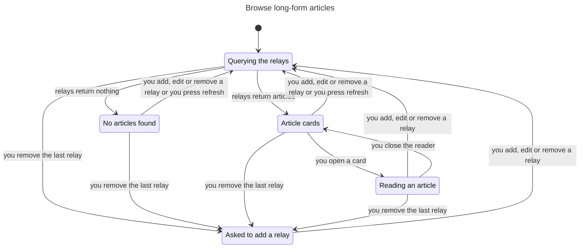

# Relay feed verification

| Skill | What it checks | Tool |
| --- | --- | --- |
| [verify-relay-feed](../../.claude/skills/verify-relay-feed/SKILL.md) | The feed shows only current relays' articles; same-slug articles from different authors both appear | TLA+ / TLC, 8 states, plus `tests/feed-rules.spec.js` |

Fixed along the way:

1. A load started before a relay was removed could finish last and bring the removed relay's articles back.
2. Articles were deduplicated by `d` tag alone, hiding one of two authors' same-slug articles.
3. The Playwright web server served a hard-coded directory from another machine.

## Browse long-form articles

Generated with pstack `/statechart` from [Browse.tla](flows/browse-articles/Browse.tla) ([TLC report](flows/browse-articles/report.md)).

